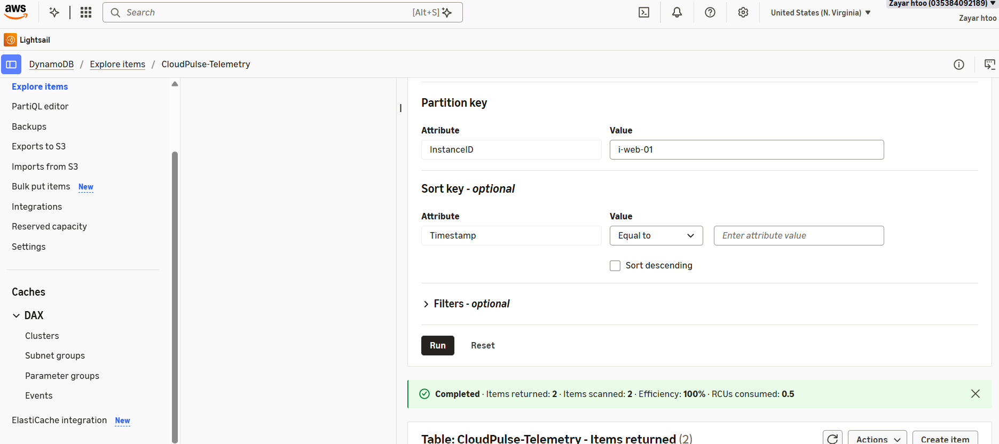

# ADR-006: Polyglot Persistence (DynamoDB & RDS) and Security Group Chaining

* **Status:** Accepted (Lab Verified)
* **Date:** 2026-11-19
* **Project:** CloudPulse AWS Architecture (SAA-C03 Study Project)
* **Schemas:** [`schemas/dynamodb-telemetry-table.json`](../schemas/dynamodb-telemetry-table.json) | [`schemas/rds-inventory-schema.sql`](../schemas/rds-inventory-schema.sql)

## Context & Problem Statement

The CloudPulse monitoring architecture handles two fundamentally different data workloads:
1. **High-velocity, semi-structured time-series telemetry** (CPU metrics, dynamic alert payloads) requiring fast key-based lookups and automatic data expiration.
2. **Structured server inventory records** (instance IDs, roles, lifecycle states) requiring strict ACID compliance and relational SQL querying.

Additionally, the relational database must be isolated from public internet access and protected against dynamic EC2 IP changes when instances stop, start, or scale.

## Architecture Overview

```text
                       [ AWS Region: us-east-1 (Default VPC) ]
                                          |
    +-------------------------------------+-------------------------------------+
    |                                                                           |
    v                                                                           v
[ Amazon DynamoDB ]                                                  [ EC2 Compute Tier ]
Table: CloudPulse-Telemetry                                          Instance: zayartesting1
- PK: InstanceID (String)                                            Private IP: 172.31.18.15
- SK: Timestamp (String)                                             SG: launch-wizard-1
- Mode: On-Demand                                                    (sg-04b6d522faf2b0173)
- TTL: ExpireAt (0 WCU auto-delete)                                             |
                                                                                | TCP 3306
                                                                                | (Private VPC Traffic)
                                                                                v
                                                                     [ Amazon RDS (MySQL 8.4.11) ]
                                                                     DB: cloudpulse-inventory-db
                                                                     Class: db.t4g.micro (Single-AZ)
                                                                     Public Access: No (Isolated)
                                                                     SG: CloudPulse-RDS-SG
                                                                     Inbound: Allow 3306 ONLY from
                                                                              sg-04b6d522faf2b0173
```

## Architectural Decisions

### 1. Polyglot Persistence (DynamoDB + RDS MySQL)
* **Telemetry -> Amazon DynamoDB (`CloudPulse-Telemetry`):**
  * **Key Schema:** Composite Primary Key (`InstanceID` Partition Key + `Timestamp` Sort Key) to support chronological range queries per server.
  * **Capacity Mode:** On-Demand (`PAY_PER_REQUEST`) to eliminate idle provisioning costs during unpredictable telemetry bursts.
  * **Schemaless Verification:** Inserted items for `i-web-01` with varying attributes (`Status: Healthy` vs. `AlertMessage: High CPU spike`) without schema migrations.
  * **Query Efficiency:** Targeted `Query` on `InstanceID = i-web-01` returned **2 items**, scanned **2 items** (**100% efficiency**), and consumed **0.5 RCU**.
* **Inventory -> Amazon RDS for MySQL (`cloudpulse-inventory-db`):**
  * **Configuration:** MySQL `8.4.11`, Sandbox/Free Tier (`db.t4g.micro`, Single-AZ, `20 GiB` gp2 SSD, Storage Autoscaling disabled).
  * **Cost Guardrails:** Disabled RDS Extended Support, Enhanced Monitoring, RDS Proxy, and CloudWatch Log Exports.



### 2. DynamoDB TTL over Scheduled Cleanup Jobs
* Enabled **Time to Live (TTL)** on the `ExpireAt` attribute (Unix Epoch timestamp) instead of custom cron/Lambda delete loops.
* **Trade-off:** Expired records are removed asynchronously in the background (typically within 48 hours) rather than instantaneously, which is acceptable for telemetry retention and incurs **0 WCU** deletion cost.

### 3. Private Isolation & Security Group Chaining (Zero-IP Firewalling)
* Configured RDS with **Public Access: No** inside the Default VPC (`vpc-00a26de2fef3c98f8`) so the instance receives no public IP address.
* Configured `CloudPulse-RDS-SG` inbound rule for **MySQL/Aurora (`TCP 3306`)** to reference the EC2 security group **`launch-wizard-1` (`sg-04b6d522faf2b0173`)** instead of hardcoding IP/CIDR blocks.

| Security Group | Direction | Protocol / Port | Source | Purpose |
| :--- | :--- | :--- | :--- | :--- |
| `CloudPulse-RDS-SG` | Inbound | TCP `3306` (MySQL/Aurora) | `sg-04b6d522faf2b0173` (`launch-wizard-1`) | Allow database access strictly from authorized EC2 instances |

## Verification & SQL Proof

Connected from `zayartesting1` (Amazon Linux 2023) using `mariadb105`:

```bash
sudo dnf install -y mariadb105
mysql -h cloudpulse-inventory-db.<endpoint-hash>.us-east-1.rds.amazonaws.com -P 3306 -u admin -p
```

An initial mistyped password returned `Access denied for user 'admin'@'172.31.18.15'`, confirming traffic traversed the private VPC network directly. After authenticating, SQL operations succeeded:

```text
Welcome to the MariaDB monitor.
Server version: 8.4.11 Source distribution

MySQL [(none)]> CREATE DATABASE cloudpulse_inventory;
Query OK, 1 row affected (0.027 sec)

MySQL [(none)]> USE cloudpulse_inventory;
Database changed

MySQL [cloudpulse_inventory]> CREATE TABLE servers (instance_id VARCHAR(50), role VARCHAR(50), status VARCHAR(20));
Query OK, 0 rows affected (0.054 sec)

MySQL [cloudpulse_inventory]> INSERT INTO servers VALUES ('i-web-01', 'Web-Server', 'Active');
Query OK, 1 row affected (0.011 sec)

MySQL [cloudpulse_inventory]> SELECT * FROM servers;
+-------------+------------+--------+
| instance_id | role       | status |
+-------------+------------+--------+
| i-web-01    | Web-Server | Active |
+-------------+------------+--------+
1 row in set (0.002 sec)
```

## Real-World Troubleshooting Notes

1. **VPC Alignment:** RDS defaulted to `Create new VPC`. Because Security Group Chaining requires both resources in the same VPC (and an RDS instance's VPC is immutable after launch), it was switched to the `Default VPC` prior to creation.
2. **SG Rule Type Replacement:** Overwriting an existing `/32` IPv4 CIDR rule directly with a Security Group ID fails with `You may not specify a referenced group id for an existing IPv4 CIDR rule`. Resolved by deleting the CIDR row first and adding a new rule referencing `sg-04b6d522faf2b0173`.
3. **Client SSL Flag Syntax:** Amazon Linux 2023's `mariadb105` client uses `--ssl-verify-server-cert` rather than the MySQL 8 client's `--ssl-mode=VERIFY_IDENTITY`.

## Cost Hygiene & Consequences

* **Teardown:** Deleted `cloudpulse-inventory-db` (without final snapshot or retained automated backups) and stopped EC2 `zayartesting1`. Left On-Demand DynamoDB table (`CloudPulse-Telemetry`) intact at $0 idle cost.
* **Production Trade-offs:** Production deployment would add Multi-AZ failover, dedicated private DB subnets, AWS Secrets Manager for credential rotation, and a VPC Gateway Endpoint for DynamoDB.

## Learning Context & AI Assistance Disclosure

Built as part of my hands-on study repository as a first-year Computer Science undergraduate preparing for the **AWS Certified Solutions Architect – Associate (SAA-C03)** exam. I transparently use **Gemini AI** as a study mentor for architecture review, live troubleshooting, and documentation structuring while personally deploying and verifying all AWS resources and commands.
