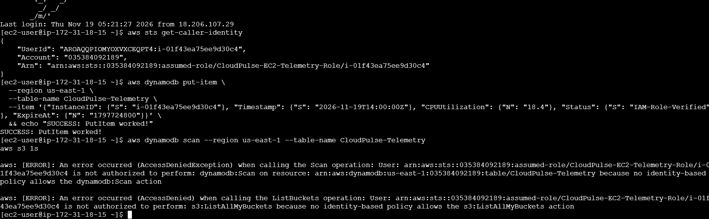

# ADR-007: IAM Least Privilege & EC2 Instance Profile (STS Temporary Credentials)

* **Status:** Accepted (Lab Verified)
* **Date:** 2026-11-19
* **Project:** CloudPulse AWS Architecture (SAA-C03 Study Project)
* **Policies:** [`policies/iam-sts-trust-policy.json`](../policies/iam-sts-trust-policy.json) | [`policies/iam-telemetry-least-privilege.json`](../policies/iam-telemetry-least-privilege.json)

## Context & Problem Statement

The CloudPulse EC2 telemetry node (`zayartesting1` / `i-01f43ea75ee9d30c4`) needs to write server metrics directly into the `CloudPulse-Telemetry` DynamoDB table. Storing long-lived IAM User access keys (`AKIA...`) on the EC2 filesystem or inside application code introduces severe credential-leak risks and operational overhead for key rotation.

Furthermore, attaching overly permissive AWS-managed policies such as `AmazonDynamoDBFullAccess` violates the **Principle of Least Privilege**, expanding the blast radius if an EC2 instance is ever compromised.

## Architecture Overview

```text
[ EC2 Instance: zayartesting1 (i-01f43ea75ee9d30c4) ]
    |
    | 1. Requests temporary credentials via IMDSv2 + Instance Profile
    v
[ AWS STS (sts:AssumeRole) ]
    | Trust Policy: ec2.amazonaws.com ONLY
    | Role: CloudPulse-EC2-Telemetry-Role
    v
[ Least-Privilege Permission Policy: CloudPulse-Telemetry-Write-Policy ]
    |
    +---> ALLOW: dynamodb:PutItem on arn:aws:dynamodb:us-east-1:<AWS_ACCOUNT_ID>:table/CloudPulse-Telemetry
    |
    +---> IMPLICIT DENY: dynamodb:Scan / DeleteTable / GetItem
    +---> IMPLICIT DENY: s3:ListAllMyBuckets and all other AWS services
```

## Architectural Decisions

### 1. Zero Static Credentials via EC2 Instance Profile & AWS STS
* Created IAM Role **`CloudPulse-EC2-Telemetry-Role`** with a service trust policy allowing only `ec2.amazonaws.com` to call `sts:AssumeRole`.
* Attached the role directly to EC2 instance `zayartesting1` so the AWS CLI/SDK automatically retrieves short-lived, auto-rotating credentials from IMDSv2 without storing any secrets on disk.

### 2. Strict Action & Resource Scoping (Least Privilege)
* Authored customer-managed policy **`CloudPulse-Telemetry-Write-Policy`** granting strictly **one action** (`dynamodb:PutItem`) scoped exclusively to **one resource ARN** (`CloudPulse-Telemetry` table in `us-east-1`).
* Relied on IAM's **Implicit Deny** default to block all unauthorized read (`dynamodb:Scan`), destructive actions, and cross-service access (`s3:*`).

## Live Terminal Verification

Verified directly from `zayartesting1` (`ec2-user@ip-172-31-18-15`) via EC2 Instance Connect with no `aws configure` credentials stored on the host:



### Test 1: STS Temporary Identity Proof
```bash
$ aws sts get-caller-identity
{
    "UserId": "AROA...:<instance-id>",
    "Account": "<AWS_ACCOUNT_ID>",
    "Arn": "arn:aws:sts::<AWS_ACCOUNT_ID>:assumed-role/CloudPulse-EC2-Telemetry-Role/i-01f43ea75ee9d30c4"
}
```

### Test 2: Authorized Write (`dynamodb:PutItem`) — Expected: PASS
```bash
$ aws dynamodb put-item \
  --region us-east-1 \
  --table-name CloudPulse-Telemetry \
  --item '{"InstanceID": {"S": "i-01f43ea75ee9d30c4"}, "Timestamp": {"S": "2026-11-19T14:00:00Z"}, "CPUUtilization": {"N": "18.4"}, "Status": {"S": "IAM-Role-Verified"}, "ExpireAt": {"N": "1797724800"}}' \
  && echo "SUCCESS: PutItem worked!"
SUCCESS: PutItem worked!
```

### Test 3: Unauthorized Read & Cross-Service Access — Expected: DENIED
```bash
$ aws dynamodb scan --region us-east-1 --table-name CloudPulse-Telemetry
aws: [ERROR]: An error occurred (AccessDeniedException) when calling the Scan operation:
User: arn:aws:sts::<AWS_ACCOUNT_ID>:assumed-role/CloudPulse-EC2-Telemetry-Role/i-01f43ea75ee9d30c4
is not authorized to perform: dynamodb:Scan on resource:
arn:aws:dynamodb:us-east-1:<AWS_ACCOUNT_ID>:table/CloudPulse-Telemetry
because no identity-based policy allows the dynamodb:Scan action

$ aws s3 ls
aws: [ERROR]: An error occurred (AccessDenied) when calling the ListBuckets operation:
User: arn:aws:sts::<AWS_ACCOUNT_ID>:assumed-role/CloudPulse-EC2-Telemetry-Role/i-01f43ea75ee9d30c4
is not authorized to perform: s3:ListAllMyBuckets because no identity-based policy allows the s3:ListAllMyBuckets action
```

## Cost Hygiene & Consequences

* **Cost Footprint:** IAM roles, policies, and STS token issuance are **$0.00**. Stopped EC2 instance `zayartesting1` immediately after verification.
* **Positive:** Zero static credentials on EC2; compromised compute instances cannot read/exfiltrate telemetry history (`dynamodb:Scan`) or pivot to S3 buckets.
* **Trade-offs:** Any future operational requirement (such as CloudWatch Logs shipping or SSM Session Manager) requires intentionally adding explicit scoped permissions to the role rather than relying on broad wildcards.

## Learning Context & AI Assistance Disclosure

Built as part of my hands-on study repository as a first-year Computer Science undergraduate preparing for the **AWS Certified Solutions Architect – Associate (SAA-C03)** exam. I transparently use **Gemini AI** as a study mentor for architecture review, live troubleshooting, and documentation structuring while personally creating, attaching, and verifying every IAM policy, role, and CLI test in my AWS account.
