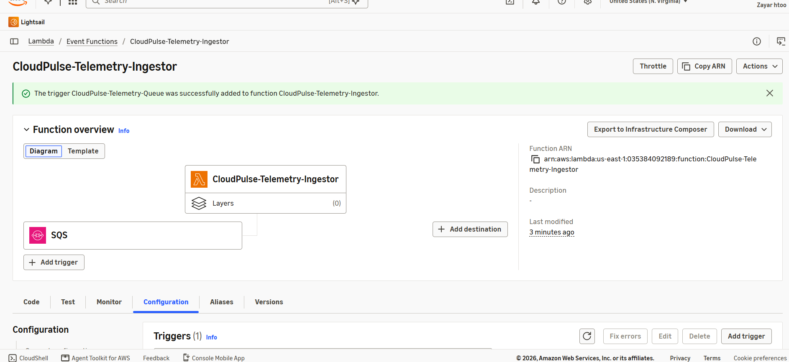
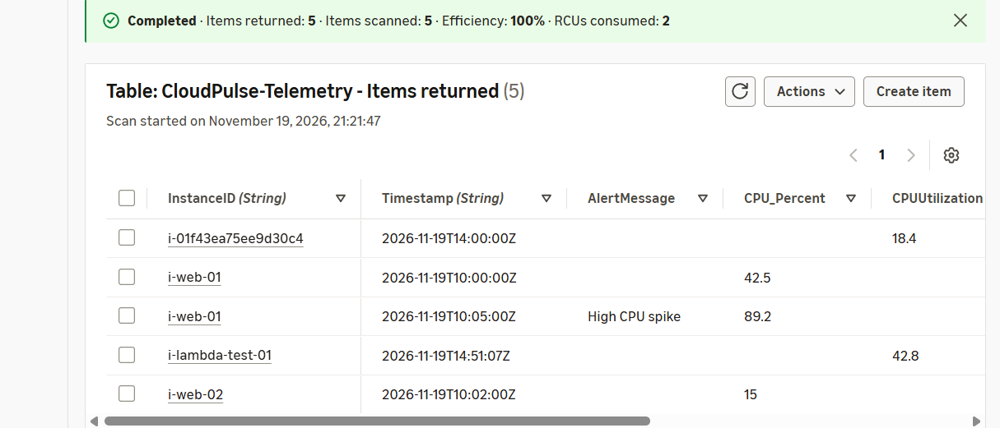

# ADR-008: Event-Driven Decoupling (SQS, DLQ, and AWS Lambda)

* **Status:** Accepted (Lab Verified)
* **Date:** 2026-11-19
* **Project:** CloudPulse AWS Architecture (SAA-C03 Study Project)
* **Code:** [`serverless/lambda_telemetry_ingestor.py`](../serverless/lambda_telemetry_ingestor.py)

## Context & Problem Statement

In a tightly coupled monitoring design, telemetry producers write directly to the database. If traffic spikes unexpectedly or downstream writes throttle, producers block, time out, or drop telemetry packets permanently.

To achieve fault tolerance and zero-idle-cost scaling, CloudPulse introduces an asynchronous serverless ingestion buffer between telemetry emitters and Amazon DynamoDB, with automatic dead-letter isolation for malformed payloads.

## Architecture Overview

```text
[ Telemetry Producer / SQS Test Payload ]
                  |
                  v
[ Amazon SQS Standard Queue: CloudPulse-Telemetry-Queue ]
  - Visibility Timeout: 60s
  - Encryption: SSE-SQS (Amazon SQS Key)
  - Redrive Policy: maxReceiveCount = 3  ----(on repeated failure)----> [ SQS DLQ: CloudPulse-Telemetry-DLQ ]
                  |
                  | Event Source Mapping (Batch Size: 10)
                  v
[ AWS Lambda: CloudPulse-Telemetry-Ingestor (Python 3.15) ]
  - Execution Role: CloudPulse-Lambda-Ingestor-Role
    * AWSLambdaSQSQueueExecutionRole (SQS polling & CloudWatch Logs)
    * CloudPulse-Telemetry-Write-Policy (Lab 7 least-privilege PutItem)
                  |
                  v
[ Amazon DynamoDB: CloudPulse-Telemetry ]
  - Auto-populates UTC Timestamp + 7-day ExpireAt TTL
```

## Architectural Decisions

### 1. Asynchronous Buffering with Amazon SQS Standard Queue
* Provisioned **`CloudPulse-Telemetry-Queue`** (Standard Queue, SSE-SQS encryption enabled) to decouple telemetry ingestion from DynamoDB writes.
* Set **Visibility Timeout to `60` seconds** (at least 6x the default Lambda execution timeout) to prevent duplicate processing while a batch is still in flight.

### 2. Failure Isolation via Dead-Letter Queue (DLQ)
* Provisioned **`CloudPulse-Telemetry-DLQ`** and attached it to the primary queue with **`Maximum receives = 3`**.
* Malformed JSON or payloads missing `InstanceID` intentionally raise an exception in Lambda; after 3 failed attempts, SQS routes the poison-pill message to the DLQ without blocking healthy telemetry traffic.

### 3. Serverless Compute & Least-Privilege Policy Reuse
* Deployed **`CloudPulse-Telemetry-Ingestor`** (Python) triggered automatically by SQS Event Source Mapping.
* Reused the customer-managed **`CloudPulse-Telemetry-Write-Policy`** from Lab 7 alongside `AWSLambdaSQSQueueExecutionRole` inside **`CloudPulse-Lambda-Ingestor-Role`**, maintaining strict `dynamodb:PutItem` scoping to the `CloudPulse-Telemetry` ARN.

## Live End-to-End Verification

### 1. SQS Event Source Mapping Trigger
Attached `CloudPulse-Telemetry-Queue` directly to `CloudPulse-Telemetry-Ingestor` via Lambda Event Source Mapping:



### 2. Telemetry Ingestion & DynamoDB Persistence
Sent a test JSON payload to **`CloudPulse-Telemetry-Queue`**:
```json
{
  "InstanceID": "i-lambda-test-01",
  "CPUUtilization": 42.8,
  "Status": "SQS-Decoupled-OK"
}
```

Verified automatic persistence in **DynamoDB ➔ Explore items (`CloudPulse-Telemetry`)** (`Items returned: 5`, `Efficiency: 100%`, `RCUs consumed: 2`) with `InstanceID = i-lambda-test-01` recorded at `2026-11-19T14:51:07Z` alongside Lab 6 and Lab 7 items:



## Cost Hygiene & Consequences

* **Cost Footprint ($0.00):** Amazon SQS, AWS Lambda, and On-Demand DynamoDB all operate within AWS Always Free Tier limits with **$0.00 idle cost**, so the pipeline can remain safely deployed without teardown.
* **Positive:** Smooths traffic spikes, eliminates EC2 compute polling overhead, and isolates bad messages automatically.
* **Trade-offs:** Standard SQS provides at-least-once delivery (best-effort ordering); for strict deduplication or ordered telemetry streams, SQS FIFO queues or idempotent conditional writes in DynamoDB would be required.

## Learning Context & AI Assistance Disclosure

Built as part of my hands-on study repository as a first-year Computer Science undergraduate preparing for the **AWS Certified Solutions Architect – Associate (SAA-C03)** exam. I transparently use **Gemini AI** as a study mentor for architecture review, Python Lambda scaffolding, and documentation structuring while personally creating, wiring, and verifying every SQS queue, IAM role, Lambda trigger, and DynamoDB record in my AWS account.
